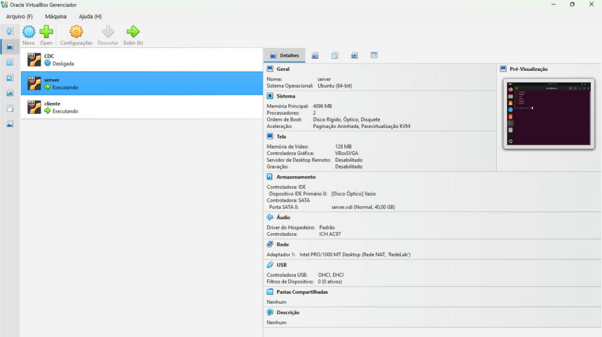
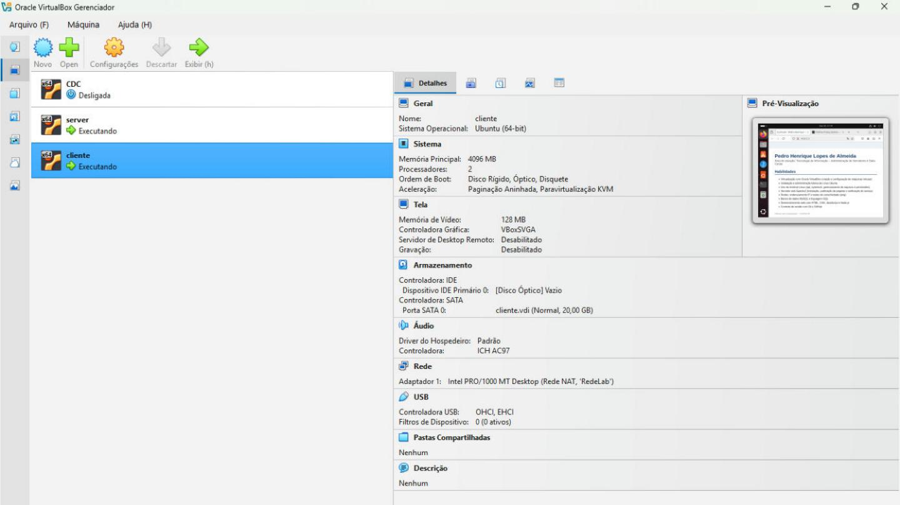
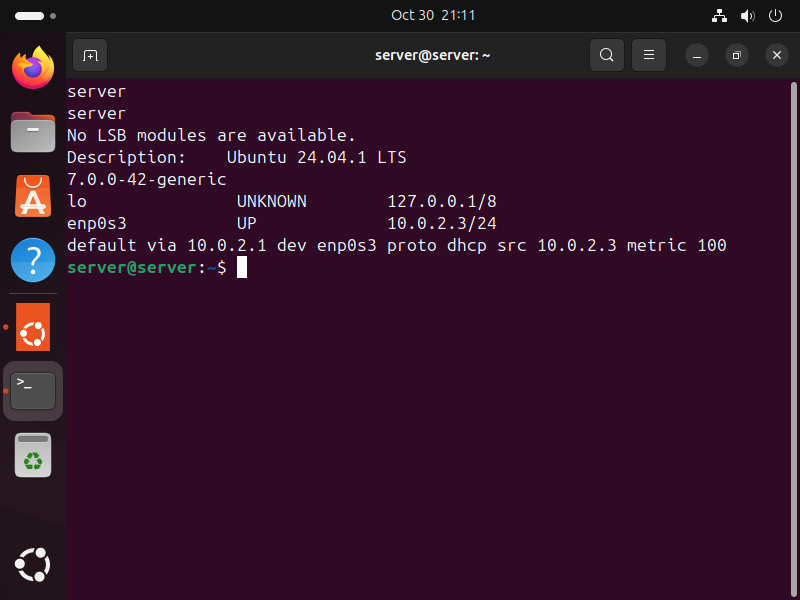
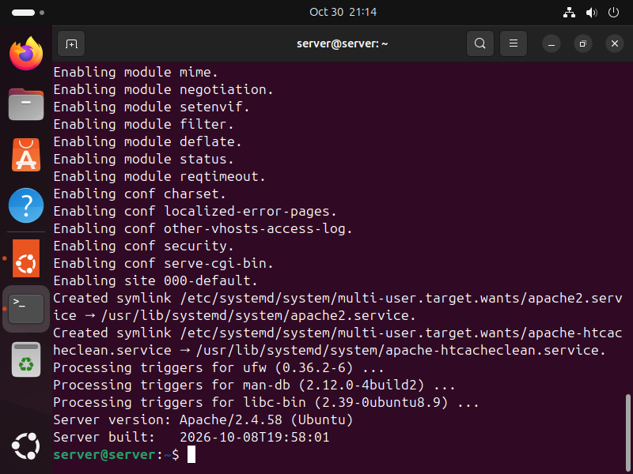
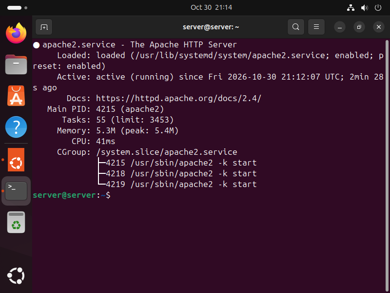
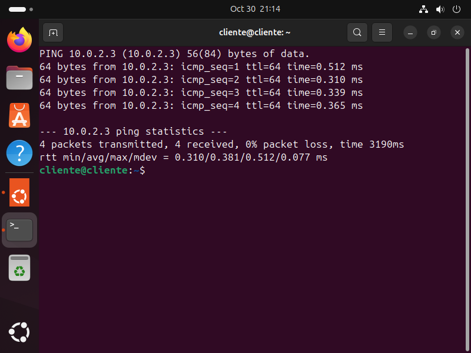
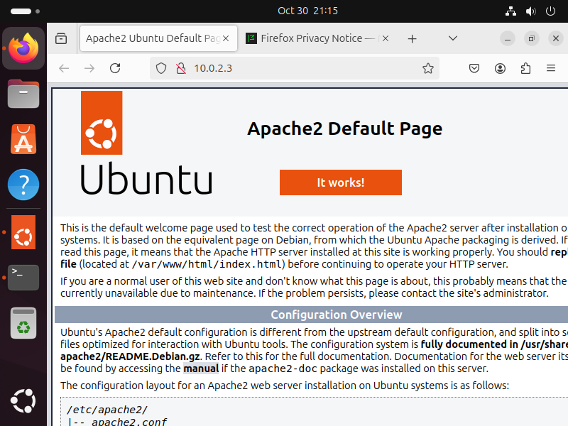
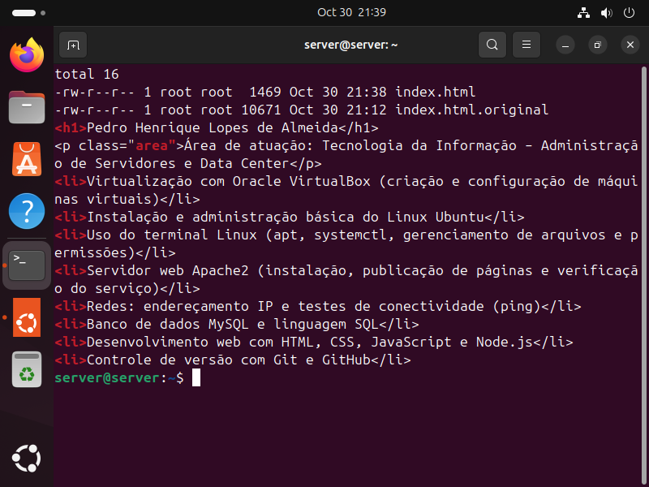
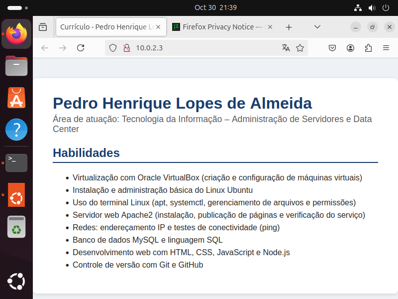

# Servidor web Apache em VMs Linux

Laboratório da disciplina *Development Tools & Cloud Computing*, **UniFECAF**.

O cenário simula o suporte a um cliente com dificuldade para colocar um servidor web no ar em Linux virtualizado. Montei no VirtualBox um ambiente com duas máquinas virtuais: uma roda o Apache2 e a outra acessa o site pelo navegador, pela rede interna.

## O que foi feito

- Criação de duas VMs Ubuntu no VirtualBox, com instalação desassistida
- Configuração de uma Rede NAT compartilhada entre as duas VMs
- Instalação e verificação do serviço Apache2
- Teste de conectividade entre cliente e servidor com `ping`
- Troca da página padrão do Apache por uma página HTML própria ([`site/index.html`](site/index.html))
- Acesso à página publicada a partir da VM cliente

## Arquitetura

```
VM cliente (10.0.2.15)                 VM server (10.0.2.3)
Ubuntu 24.04.1 + Firefox  ── HTTP ──▶  Ubuntu 24.04.1 + Apache 2.4.58
                                       /var/www/html/index.html
        └────── Rede NAT "RedeLab" (10.0.2.0/24, DHCP) ──────┘
```

| Item | VM server | VM cliente |
| --- | --- | --- |
| Sistema | Ubuntu Desktop 24.04.1 LTS | Ubuntu Desktop 24.04.1 LTS |
| Memória e CPU | 4 GB, 2 vCPUs | 4 GB, 2 vCPUs |
| Disco | 40 GB | 20 GB |
| Função | Servidor web Apache2 | Acesso pelo navegador |

## Como reproduzir

**1. Criar a rede NAT** (no computador hospedeiro, com as VMs já criadas e ligadas a essa rede):

```bash
VBoxManage natnetwork add --netname RedeLab --network "10.0.2.0/24" --enable --dhcp on
```

**2. Instalar o Apache** (na VM server):

```bash
sudo apt update
sudo apt install -y apache2
apache2 -v
systemctl status apache2 --no-pager
```

**3. Publicar a página** (na VM server, guardando a original como backup):

```bash
sudo mv /var/www/html/index.html /var/www/html/index.html.original
sudo cp site/index.html /var/www/html/index.html
```

**4. Testar** (na VM cliente):

```bash
ping -c 4 10.0.2.3
```

Depois, abra `http://10.0.2.3` no navegador da VM cliente. O IP pode ser diferente no seu ambiente: confira com `ip -br a`.

## Evidências

| Etapa | Print |
| --- | --- |
| Configuração das VMs no VirtualBox |   |
| Versão do sistema e IP |   |
| Apache instalado e serviço ativo |   |
| `ping` do cliente para o servidor |  |
| Página padrão vista pelo cliente |  |
| Página própria publicada e acessada |   |

## Autor

**Pedro Henrique Lopes de Almeida** · Ciência da Computação, UniFECAF
